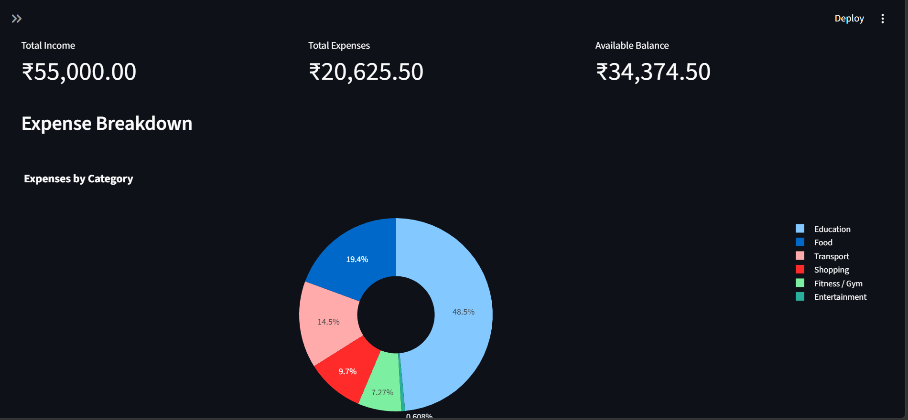
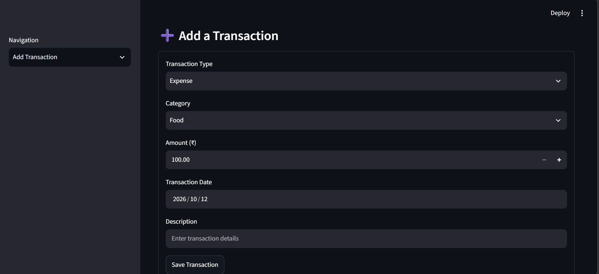
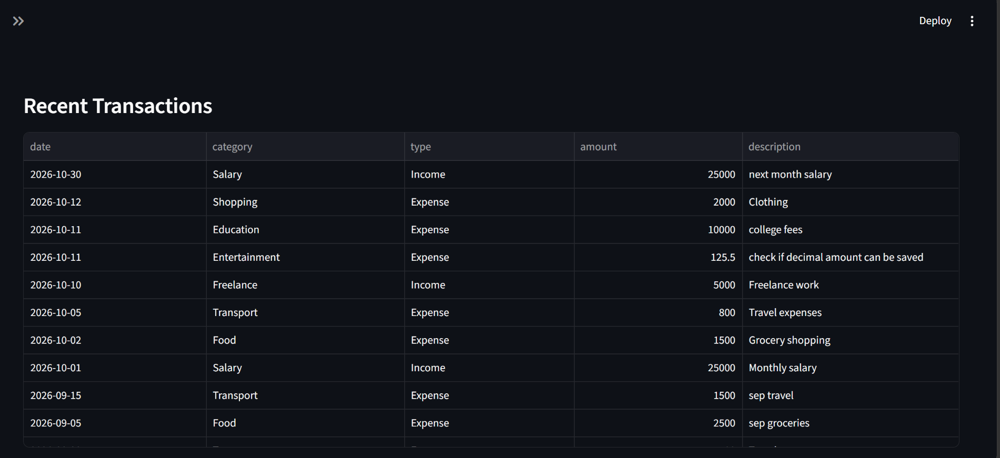
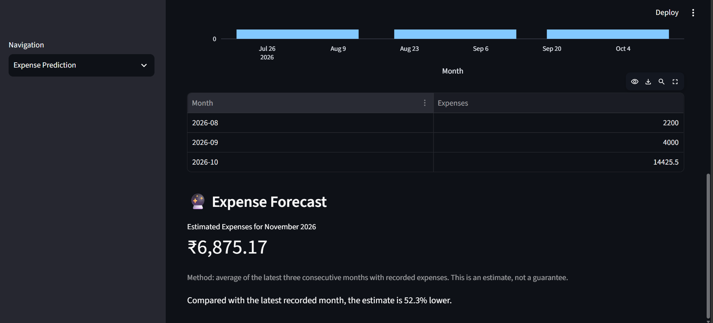
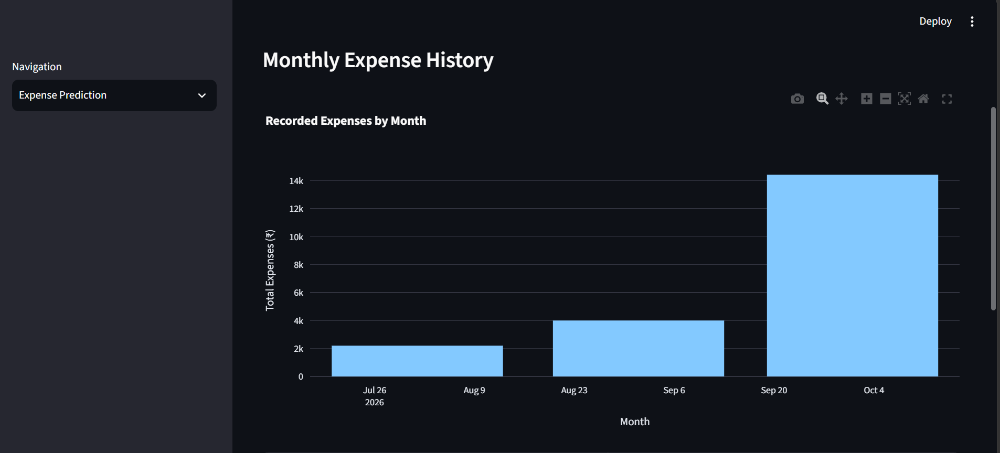

# 💰 Personal Finance Manager

A Python-based personal finance application built with Streamlit to help users manage income, track expenses, review monthly reports, and estimate future spending.

## Features

- **Dashboard:** View total income, total expenses, and available balance.
- **Transaction Management:** Add, view, edit, and delete income and expense records.
- **Monthly Reports:** Review monthly financial summaries and expense categories.
- **Expense Prediction:** Estimate next month's expenses using the average of the latest three consecutive months with recorded expenses.
- **CSV Import and Export:** Import transaction records and export financial data.
- **Duplicate Detection:** Detect and skip duplicate transactions during CSV imports.
- **Data Validation:** Validate transaction dates, amounts, categories, and required fields.
- **Interactive Charts:** Visualize spending patterns using Plotly.
- **SQLite Database:** Store transaction records locally.

## 📸 Application Screenshots

### Dashboard


### Add Transaction


### View Transactions


### Edit and Delete Transactions


### Expense Forecast


### Expense Prediction


### CSV Import and Export


## Technologies Used

- Python
- Streamlit
- Pandas
- Plotly
- SQLite

## Installation and Setup

### Prerequisites

- Python 3.10 or a compatible version supported by the installed dependencies
- Git (to clone the repository)

### 1. Clone the repository

Replace the placeholder URL with your GitHub repository URL.

```bash
git clone YOUR_GITHUB_REPOSITORY_URL
cd YOUR_PROJECT_FOLDER
```

### 2. Create a virtual environment

```bash
python -m venv venv
```

### 3. Activate the environment

**Windows PowerShell:**

```powershell
.\venv\Scripts\Activate.ps1
```

### 4. Install dependencies

```bash
python -m pip install -r requirements.txt
```

### 5. Run the application

```bash
python -m streamlit run app.py
```

The application will usually open in your browser at http://localhost:8501.

## Database and Privacy

The application uses a local SQLite database named `finance.db` to store transaction records.

The database and virtual environment are excluded from Git using `.gitignore`. When running a fresh copy of the project without an existing database, the application creates its database and transaction table locally.

**Note:** This project currently provides local transaction management and does not implement separate user accounts or multi-user authentication. Do not use it to store sensitive financial information.

## Future Improvements

- User authentication and individual user accounts
- Budget limits and spending alerts
- More detailed financial analytics
- Enhanced expense forecasting

## Author

**Vaishnavi Rajure**

Copyright © 2026 Vaishnavi Rajure.

## License

This project is licensed under the MIT License. See the [LICENSE](LICENSE) file for details.